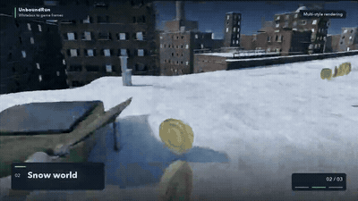
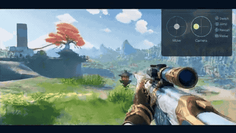
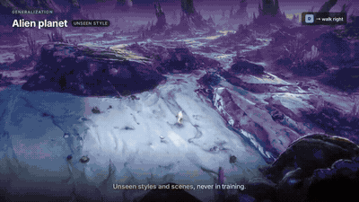
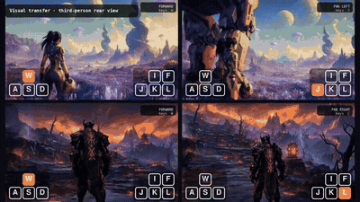
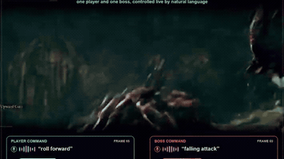

**Real-time interactive game world models.** *Press a key, and the model draws the next frame of the game world.*

[Homepage](https://jinyeying.github.io/) · [Agentic gameplay](#agentic-gameplay-and-real-time-world-editing) · [Action & language control](#spatially-consistent-action-and-language-control) · [NPC behavior](#state-aware-gameplay-and-npc-behavior) · [Agentic video](#beyond-games-agentic-video) · [Join us](#join-us)

**13 projects · 11 papers · 12 open-source codebases · 9 models · 6 datasets**

https://github.com/user-attachments/assets/e070b091-178b-4faf-be39-83f433563232

Yeying Lab is led by [Yeying Jin](https://jinyeying.github.io/), Staff Researcher at Tencent and Adjunct Faculty at NUS ECE.
We build video world models that players can steer, edit and play in real time: agents that run the game while a video model renders it, action and language control that stays spatially consistent, and NPCs that read the game state and react to players.

> These are technical explorations, not commercial games.

## Agentic gameplay and real-time world editing

<table>
<tr>
<td width="50%" valign="top">

<b>MaLiang</b>&nbsp;  <i>Painting Playable Game Worlds from Numbers</i>

Paint a map, and the world follows: a 4-step causal video model streams the game world in real time.

 · <a href="https://github.com/YeyingLab/MaLiang/releases/tag/v1.0-models">Model</a>

</td>
<td width="50%" valign="top">

<b>Wizard</b>&nbsp;  <i>Manipulate Any World in Real Time via Agentic Control</i>

Reshape any world in plain language; a video model renders the edits at 24 FPS in 2 steps.

🎓 Co-first authors: <a href="https://nadia.sg/people/wu-yuzhe/">Yuzhe Wu</a>, <a href="https://jimntu.github.io/">Zijun Lin</a>

<a href="https://arxiv.org/abs/2610.40339">arXiv</a> · <a href="https://wyzardwu.github.io/wizard/">Project</a> ·  · <a href="https://huggingface.co/datasets/yuzhewu207/wizard/tree/main/weights">🤗 Model</a> · 

</td>
</tr>
<tr>
<td width="50%" valign="top">

<b>UnboundRun</b>&nbsp; 

Endless parkour in many art styles, rendered live at 40 fps.

<i>Code coming soon</i>

</td>
<td width="50%" valign="top">

<b>GameCrafter</b>&nbsp;  <i>An Agentic Framework for Multi-Gameplay Game World Generation</i>

One prompt builds a multi-gameplay 3D game world; best overall score (87.77) on a ten-task benchmark.

🎓 Co-first authors: <a href="https://teawhite.cn/">Zhiyang Deng</a>, Xiyao Deng

<a href="https://github.com/YeyingLab/GameCrafter/blob/main/paper/GameCrafter.pdf">Paper</a> · <a href="https://teawhite.cn/GameCrafter/">Project</a> ·  · 

</td>
</tr>
<tr>
<td width="50%" valign="top">

<b>GameDirector</b>&nbsp;  <i>Decoupling Gameplay Logic from Rendering for Player-Configurable Game World Models</i>

An agent runs the rules, states and NPC tactics while a world model renders them: boss action quality +39.9%.

🎓 Co-first authors: <a href="https://jimntu.github.io/">Zijun Lin</a>, <a href="https://teawhite.cn/">Zhiyang Deng</a>

<a href="https://arxiv.org/abs/2609.25652">arXiv</a> · <a href="https://jimntu.github.io/gamedirector/">Project</a> ·  ·  · 

</td>
<td width="50%"></td>
</tr>
</table>

## Spatially consistent action and language control

<table>
<tr>
<td width="50%" valign="top">

<b>SCOPE</b>&nbsp;  <i>Simulating Cross-game Operations in Playable Environments for FPS World Models</i>

An FPS world model trained on CrossFPS, the first multi-game FPS dataset: 69K clips, 7 titles, 10-DoF controls.

🎓 First author: <a href="https://github.com/z2tong">Zizhao Tong</a>

<a href="https://arxiv.org/abs/2605.23345">arXiv</a> · <a href="https://z2tong.github.io/SCOPE/">Project</a> ·  ·  · <a href="https://huggingface.co/collections/zizhaotong/crossfps">🤗 Data</a>

</td>
<td width="50%" valign="top">

<b>ActionRoPE</b>&nbsp;  <i>Action as Coordinates for Spatially Consistent Control in Planar-Camera Game World Models</i>

Actions become world-coordinate rotary positions: 66% less revisit drift, on 1.3B–33B backbones.

🎓 First author: <a href="https://teawhite.cn/">Zhiyang Deng</a>

<a href="https://arxiv.org/abs/2610.25861">arXiv</a> · <a href="https://teawhite.cn/ActionRoPE/">Project</a> ·  · 

</td>
</tr>
<tr>
<td width="50%" valign="top">

<b>H3-World</b>&nbsp;  <i>Turning Language Understanding into World Control</i>

Turns a video model's language understanding into character and camera control, training only 0.199% of parameters.

🎓 Co-first authors: <a href="https://danzer1xxxxchan.github.io/">Danze Chen</a>, <a href="https://inv-wzq.github.io/">Zeqing Wang</a>

<a href="https://arxiv.org/abs/2609.01560">arXiv</a> · <a href="https://danzer1xxxxchan.github.io/H3-World/">Project</a> ·  · 

</td>
<td width="50%" valign="top">

<b>Incantation</b>&nbsp;  <i>Natural Language as the Action Interface for Multi-Entity Video World Models</i>

Command many characters in plain language: 89% cross-entity transfer success vs. 43% for action-ID baselines.

🎓 First author: <a href="https://github.com/zhushangwen">Shangwen Zhu</a>

<a href="https://arxiv.org/abs/2605.18601">arXiv</a> · <a href="https://matrixteam-ai.github.io/pages/Incanation">Project</a> ·  · <a href="https://www.reactor.inc/incantation">Play</a> · <a href="https://huggingface.co/MatrixTeam/Incantation_preview_margit">🤗 Model</a> · 

</td>
</tr>
</table>

SCOPE and Incantation are joint projects with external collaborators.

## State-aware gameplay and NPC behavior

<table>
<tr>
<td width="50%" valign="top">

<b>WorldMind</b>&nbsp;  <i>Decoupled Game World Model for State-Aware NPC Behavior</i>

The first decoupled game world model for NPC behavior, from understanding to generation; preferred in ~70% of comparisons.

🎓 First author: <a href="https://teawhite.cn/">Zhiyang Deng</a>

<a href="https://arxiv.org/abs/2608.21439">arXiv</a> · <a href="https://teawhite.cn/worldmind_projectpage/">Project</a> · 

</td>
<td width="50%" valign="top">

<b>ReactiveGWM</b>&nbsp;  <i>Flexible Control and NPC Reactivity in Game World Models</i>

NPCs follow Offense / Defense / Control strategies and transfer zero-shot to unseen games.

🎓 First author: <a href="https://inv-wzq.github.io/">Zeqing Wang</a>

<a href="https://arxiv.org/abs/2605.15256">arXiv</a> · <a href="https://inv-wzq.github.io/ReactiveGWM/">Project</a> ·  ·  · 

</td>
</tr>
<tr>
<td width="50%" valign="top">

<b>StatePlay</b>&nbsp;  <i>State-Aware Game World Models for Mechanics-Consistent Generation</i>

Generates frames together with game states (health, meters, timers): +18.6% mechanics fidelity.

🎓 First author: <a href="https://jimntu.github.io/">Zijun Lin</a>

<a href="https://arxiv.org/abs/2607.26754">arXiv</a> · <a href="https://jimntu.github.io/stateplay_page/">Project</a> ·  ·  · 

</td>
<td width="50%"></td>
</tr>
</table>

## Beyond games: agentic video

<table>
<tr>
<td width="50%" valign="top">

<b>StoryEngine</b>&nbsp;  <i>A State-Grounded Agentic Framework for Video Storytelling</i>

Turns a story into a multi-shot video, with every shot grounded in an explicit story state.

🎓 Co-first authors: <a href="https://github.com/wwwTaylor">Yingrui Wang</a>, <a href="https://inv-wzq.github.io/">Zeqing Wang</a>

<a href="https://arxiv.org/abs/2609.33627">arXiv</a> · <a href="https://yeyinglab.github.io/StoryEngine/">Project</a> · 

</td>
<td width="50%"></td>
</tr>
</table>

## Join us

We're hiring 6-month research interns in world models and coding agents, in Singapore and through [Tencent campus recruiting](https://join.qq.com/post_detail.html?postid=1210646470286783493) in China. [Details](https://zhuanlan.zhihu.com/p/2070315664162689467)
