

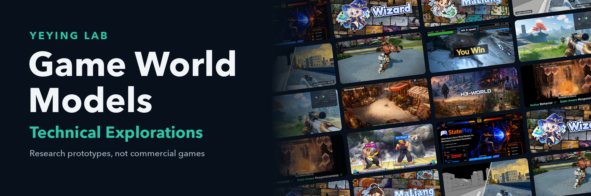

**Real-time interactive game world models.** *Press a key, and the model draws the next frame of the game world.*

[Homepage](https://jinyeying.github.io/) · [🤗 Hugging Face](https://huggingface.co/collections/yeyingjin/yeying-lab-6b09480206e083c253ed2163) · [Agentic gameplay](#agentic-gameplay-and-real-time-world-editing) · [Coding agents](#coding-agents-and-world-model-infrastructure) · [Action & language control](#spatially-consistent-action-and-language-control) · [NPC behavior](#state-aware-gameplay-and-npc-behavior) · [Agentic video](#beyond-games-agentic-video) · [Virtual try-on](#beyond-games-virtual-try-on) · [Join us](https://zhuanlan.zhihu.com/p/2070315664162689467)

**16 projects · 14 papers · 15 open-source codebases · 11 models · 9 datasets**

   

https://github.com/user-attachments/assets/e070b091-178b-4faf-be39-83f433563232

Yeying Lab is led by [Yeying Jin](https://jinyeying.github.io/) (Tencent · NUS).

📢 We're hiring 6-month research interns in world models and coding agents, in Singapore and in China. [Details](https://zhuanlan.zhihu.com/p/2070315664162689467) · [Apply on LinkedIn (Singapore, world models)](https://www.linkedin.com/jobs/view/4471500956/)

## Agentic gameplay and real-time world editing

<table>
<tr>
<td width="50%" valign="top">
<a href="https://yeyinglab.github.io/MaLiang/">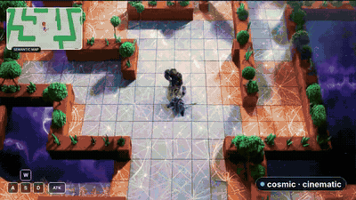</a>

<b>MaLiang</b>&nbsp;  <i>Painting Playable Game Worlds from Numbers</i>

Paint a map, and the world follows: a 4-step causal video model streams the game world in real time.

<a href="https://yeyinglab.github.io/MaLiang/">Project</a> ·  ·  · 

</td>
<td width="50%" valign="top">
<a href="https://wyzardwu.github.io/wizard/">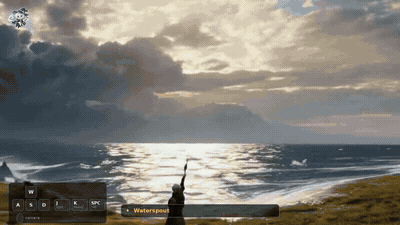</a>

<b>Wizard</b>&nbsp;  <i>Manipulate Any World in Real Time via Agentic Control</i>

Reshape any world in plain language; a video model renders the edits at 24 FPS in 2 steps.

<a href="https://arxiv.org/abs/2610.40339">arXiv</a> · <a href="https://wyzardwu.github.io/wizard/">Project</a> ·  ·  ·  · 

</td>
</tr>
<tr>
<td width="50%" valign="top">

<b>UnboundRun</b>&nbsp; 

Endless parkour in many art styles, rendered live at 40 fps.

<i>Code coming soon</i>

</td>
<td width="50%" valign="top">
<a href="https://jimntu.github.io/gamedirector/">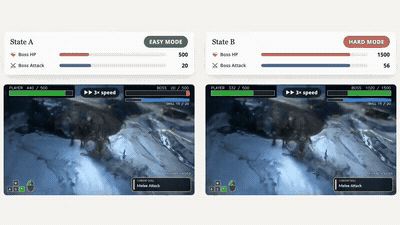</a>

<b>GameDirector</b>&nbsp;  <i>Decoupling Gameplay Logic from Rendering for Player-Configurable Game World Models</i>

An agent runs the rules, states and NPC tactics while a world model renders them: boss action quality +39.9%.

<a href="https://arxiv.org/abs/2609.25652">arXiv</a> · <a href="https://jimntu.github.io/gamedirector/">Project</a> ·  ·  ·  · 

</td>
</tr>
</table>

## Coding agents and world-model infrastructure

<table>
<tr>
<td width="50%" valign="top">
<a href="https://teawhite.cn/GameCrafter/">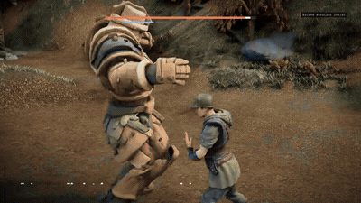</a>

<b>GameCrafter</b>&nbsp;  <i>An Agentic Framework for Multi-Gameplay Game World Generation</i>

Coding agents turn one prompt into a playable multi-gameplay 3D world; best overall score (87.77) on a ten-task benchmark.

<a href="https://github.com/YeyingLab/GameCrafter/blob/main/paper/GameCrafter.pdf">Paper</a> · <a href="https://teawhite.cn/GameCrafter/">Project</a> ·  · 

</td>
<td width="50%" valign="top">
<a href="https://openenvision.org/WorldFoundry">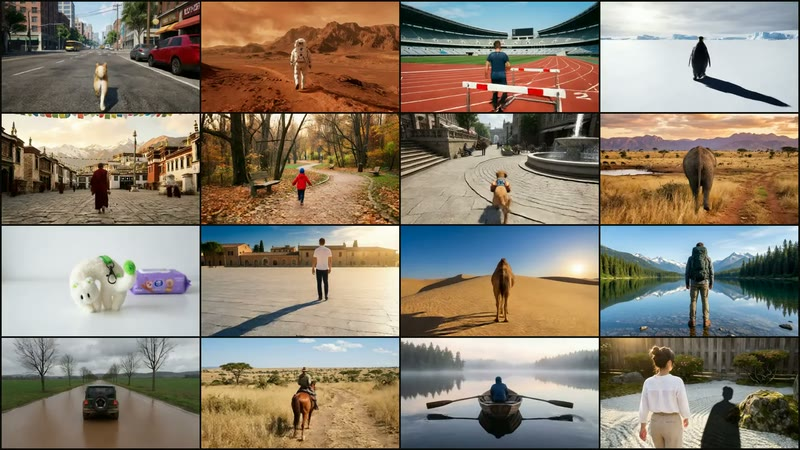</a>

<b>WorldFoundry</b>&nbsp;  <i>Towards Unified Infrastructure for World Intelligence</i>

One framework to run and evaluate world models: 270 models, 74 benchmarks and 62 metrics across video, 3D, 4D, interactive and embodied worlds. #2 on Hugging Face Daily Papers.

<a href="https://arxiv.org/abs/2611.10771">arXiv</a> · <a href="https://openenvision.org/WorldFoundry">Project</a> ·  · 

</td>
</tr>
</table>

## Spatially consistent action and language control

<table>
<tr>
<td width="50%" valign="top">

<b>SCOPE</b>&nbsp;  <i>Simulating Cross-game Operations in Playable Environments for FPS World Models</i>

An FPS world model trained on CrossFPS, the first multi-game FPS dataset: 69K clips, 7 titles, 10-DoF controls.

<a href="https://arxiv.org/abs/2605.23345">arXiv</a> · <a href="https://yeyinglab.github.io/SCOPE/">Project</a> ·  ·  ·  · 

</td>
<td width="50%" valign="top">

<b>H3-World</b>&nbsp;  <i>Turning Language Understanding into World Control</i>

Turns a video model's language understanding into character and camera control, training only 0.199% of parameters.

<a href="https://arxiv.org/abs/2609.01560">arXiv</a> · <a href="https://danzer1xxxxchan.github.io/H3-World/">Project</a> ·  ·  · 

</td>
</tr>
<tr>
<td width="50%" valign="top">

<b>ActionRoPE</b>&nbsp;  <i>Action as Coordinates for Spatially Consistent Control in Planar-Camera Game World Models</i>

Actions become world-coordinate rotary positions: 66% less revisit drift, on 1.3B–33B backbones.

<a href="https://arxiv.org/abs/2610.25861">arXiv</a> · <a href="https://teawhite.cn/ActionRoPE/">Project</a> ·  ·  · 

</td>
<td width="50%" valign="top">

<b>Incantation</b>&nbsp;  <i>Natural Language as the Action Interface for Multi-Entity Video World Models</i>

Command many characters in plain language: 89% cross-entity transfer success vs. 43% for action-ID baselines.

<a href="https://arxiv.org/abs/2605.18601">arXiv</a> · <a href="https://matrixteam-ai.github.io/pages/Incanation">Project</a> · <a href="https://www.reactor.inc/incantation">Play</a> ·  ·  · <a href="https://huggingface.co/MatrixTeam/Incantation_preview_margit">🤗 Model</a> ·  · 

</td>
</tr>
</table>

## State-aware gameplay and NPC behavior

<table>
<tr>
<td width="50%" valign="top">
<a href="https://inv-wzq.github.io/ReactiveGWM/">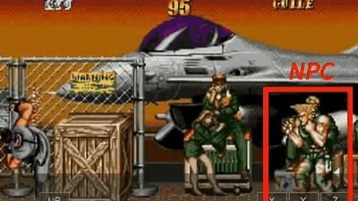</a>

<b>ReactiveGWM</b>&nbsp;  <i>Flexible Control and NPC Reactivity in Game World Models</i>

NPCs follow Offense / Defense / Control strategies and transfer zero-shot to unseen games.

<a href="https://arxiv.org/abs/2605.15256">arXiv</a> · <a href="https://inv-wzq.github.io/ReactiveGWM/">Project</a> ·  ·  ·  · 

</td>
<td width="50%" valign="top">
<a href="https://jimntu.github.io/stateplay_page/">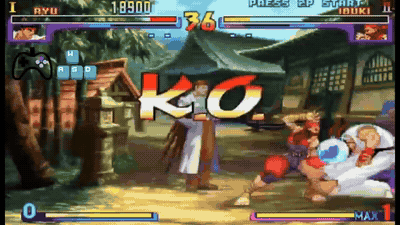</a>

<b>StatePlay</b>&nbsp;  <i>State-Aware Game World Models for Mechanics-Consistent Generation</i>

Generates frames together with game states (health, meters, timers): +18.6% mechanics fidelity.

<a href="https://arxiv.org/abs/2607.26754">arXiv</a> · <a href="https://jimntu.github.io/stateplay_page/">Project</a> ·  ·  ·  · 

</td>
</tr>
<tr>
<td width="50%" valign="middle">
<a href="https://teawhite.cn/worldmind_projectpage/">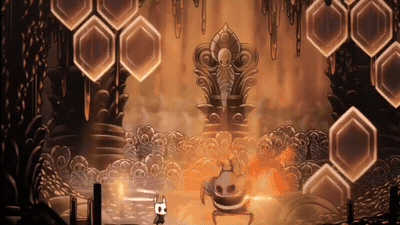</a>
</td>
<td width="50%" valign="middle">

<b>WorldMind</b>&nbsp;  <i>Decoupled Game World Model for State-Aware NPC Behavior</i>

The first decoupled game world model for NPC behavior, from understanding to generation; preferred in ~70% of comparisons.

<a href="https://arxiv.org/abs/2608.21439">arXiv</a> · <a href="https://teawhite.cn/worldmind_projectpage/">Project</a> ·  · 

</td>
</tr>
</table>

## Beyond games: agentic video

<table>
<tr>
<td width="50%" valign="middle">

</td>
<td width="50%" valign="middle">

<b>StoryEngine</b>&nbsp;  <i>A State-Grounded Agentic Framework for Video Storytelling</i>

Turns a story into a multi-shot video, with every shot grounded in an explicit story state.

<a href="https://arxiv.org/abs/2609.33627">arXiv</a> · <a href="https://yeyinglab.github.io/StoryEngine/">Project</a> ·  · 

</td>
</tr>
</table>

## Beyond games: virtual try-on

<table>
<tr>
<td width="50%" valign="top">
<a href="https://yeyinglab.github.io/BooM-VVT/">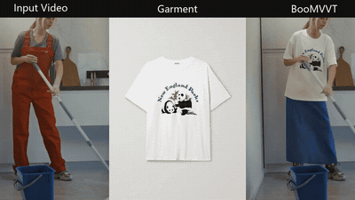</a>

<b>BooM-VVT</b>&nbsp;  <i>Boosting Mask-Free Video Virtual Try-On with Image-Level Pseudo Data</i>

Dresses a person in any garment across a whole video without masks, trained with image-level pseudo data.

<a href="https://arxiv.org/abs/2609.04120">arXiv</a> · <a href="https://yeyinglab.github.io/BooM-VVT/">Project</a> ·  ·  ·  · 

</td>
<td width="50%" valign="top">
<a href="https://github.com/YeyingLab/UniFit">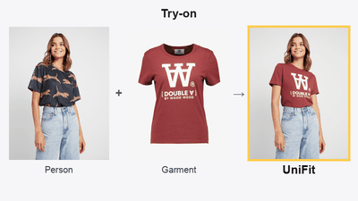</a>

<b>UniFit</b>&nbsp;  <i>Towards Universal Virtual Try-on with MLLM-Guided Semantic Alignment</i>

One model for many try-on tasks (multi-garment, model-to-model, model-free), aligned by a multimodal LLM.

<a href="https://arxiv.org/abs/2511.15831">arXiv</a> · <a href="https://ojs.aaai.org/index.php/AAAI/article/view/38279">Paper</a> ·  ·  · 

</td>
</tr>
</table>
